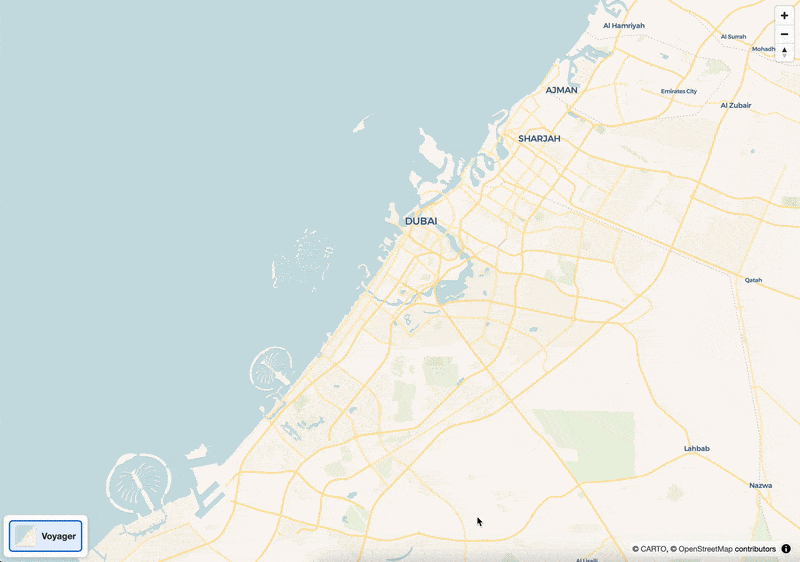
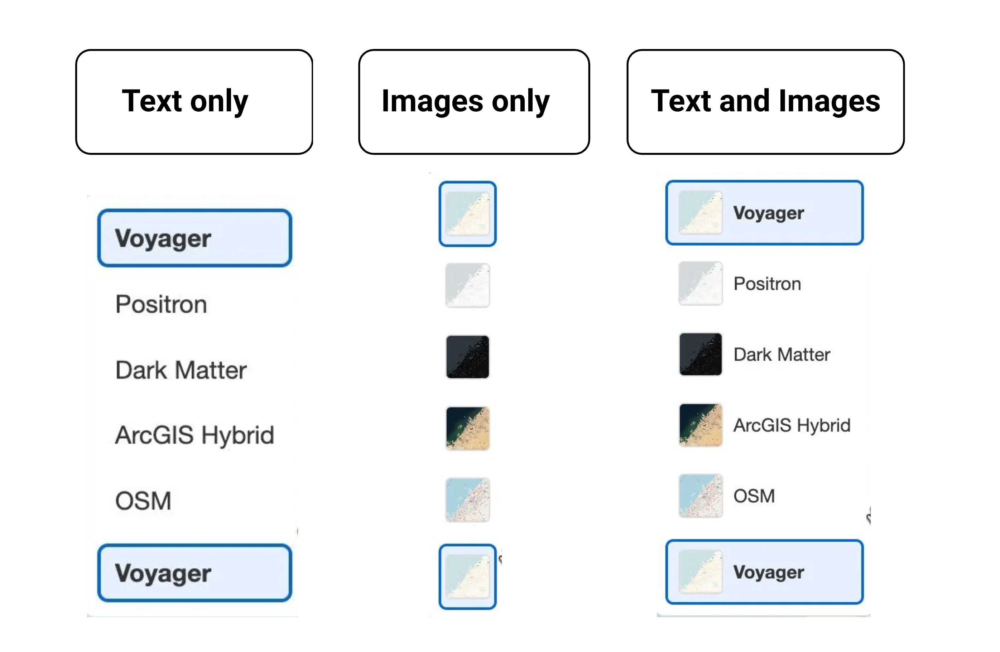

# Map GL Style Switcher

[](https://badge.fury.io/js/map-gl-style-switcher)
[](https://github.com/muimsd/map-gl-style-switcher/actions/workflows/ci.yml)
[](https://opensource.org/licenses/MIT)
[](https://app.netlify.com/projects/map-gl-style-switcher/deploys)

[](https://codecov.io/gh/muimsd/map-gl-style-switcher)

A TypeScript control for switching Mapbox GL / MapLibre GL map styles. Easily add a floating style switcher to your map app, with support for multiple styles, images, dark/light themes, and before/after change callbacks.

**Available as:**

- `StyleSwitcherControl` - Direct IControl implementation for Mapbox/MapLibre GL
- `MapGLStyleSwitcher` - React component for react-map-gl integration
- `useStyleSwitcher` - React hook for custom map instances

**<a href="https://map-gl-style-switcher.netlify.app/" target="_blank">🌐 Live Demo</a>**

## Animated Demo



## Available Styles



## Features

- IControl implementation for Mapbox GL / MapLibre GL
- **React component for react-map-gl integration**
- **React hook for custom map instances**
- Floating style switcher in any corner (via map.addControl position)
- Support for multiple map styles with thumbnails
- Expand/collapse on hover or tap with smooth animations
- Lightweight thumbnails: list images load on first open and are never re-created
- Dark/light/auto theme support — `theme: 'auto'` reacts to OS preference changes in real time
- RTL text support for Arabic/Hebrew interfaces
- Configurable display options (show/hide labels and images)
- Callbacks for before/after style change
- `updateOptions()` for imperative option updates after mount
- Fully customizable CSS classes and colour variables
- TypeScript support
- Accessible: WAI-ARIA select-only combobox with full keyboard support
- ESM-only package (tree-shakeable, no CommonJS bundle)
- Comprehensive test coverage

## Install

```sh
# Using npm (recommended)
npm install map-gl-style-switcher

# Using yarn
yarn add map-gl-style-switcher

# Using pnpm
pnpm add map-gl-style-switcher
```

> **Note:** This package ships ES modules only. CommonJS `require()` is not supported. All modern bundlers (Vite, webpack 5, Rollup, esbuild) handle ESM natively.

## Usage

### Vanilla JS / Direct MapLibre or Mapbox GL

```ts
import { StyleSwitcherControl, type StyleItem } from 'map-gl-style-switcher';
import 'map-gl-style-switcher/dist/map-gl-style-switcher.css';

const styles: StyleItem[] = [
  {
    id: 'voyager',
    name: 'Voyager',
    image:
      'https://raw.githubusercontent.com/muimsd/map-gl-style-switcher/refs/heads/main/public/voyager.png',
    styleUrl: 'https://basemaps.cartocdn.com/gl/voyager-gl-style/style.json',
    description: 'Voyager style from Carto',
  },
  {
    id: 'positron',
    name: 'Positron',
    image:
      'https://raw.githubusercontent.com/muimsd/map-gl-style-switcher/refs/heads/main/public/positron.png',
    styleUrl: 'https://basemaps.cartocdn.com/gl/positron-gl-style/style.json',
    description: 'Positron style from Carto',
  },
];

const control = new StyleSwitcherControl({
  styles,
  activeStyleId: 'voyager',
  theme: 'auto',
  onAfterStyleChange: (_from, to) => {
    map.setStyle(to.styleUrl);
  },
});

map.addControl(control, 'bottom-left');
```

### React — `useStyleSwitcher` hook (custom map instance)

Use this when you manage the map instance yourself (e.g., inside `useEffect`):

```tsx
import { useEffect, useRef, useState } from 'react';
import maplibregl from 'maplibre-gl';
import { useStyleSwitcher, type StyleItem } from 'map-gl-style-switcher/react';
import 'maplibre-gl/dist/maplibre-gl.css';
import 'map-gl-style-switcher/dist/map-gl-style-switcher.css';

const styles: StyleItem[] = [
  /* ... */
];

function MapComponent() {
  const mapContainer = useRef<HTMLDivElement>(null);
  const [map, setMap] = useState<maplibregl.Map | null>(null);

  useEffect(() => {
    if (!mapContainer.current) return;
    const instance = new maplibregl.Map({
      container: mapContainer.current,
      style: styles[0].styleUrl,
      center: [0, 0],
      zoom: 2,
    });
    setMap(instance);
    return () => instance.remove();
  }, []);

  useStyleSwitcher(map, {
    styles,
    theme: 'auto',
    position: 'bottom-left',
    onAfterStyleChange: (_from, to) => {
      map?.setStyle(to.styleUrl);
    },
  });

  return <div ref={mapContainer} style={{ width: '100%', height: '500px' }} />;
}
```

> **Note:** Keep the map in state, not in a ref: changing `ref.current` does not re-render, so the hook would never see the map. Option changes update the existing control, and callbacks always use their latest version. The hook returns the control, or `null` until it has been added.

### React — `MapGLStyleSwitcher` component (react-map-gl)

Use this when your map is rendered by `react-map-gl`:

```tsx
import { useState } from 'react';
import { Map } from 'react-map-gl/maplibre';
import { MapGLStyleSwitcher, type StyleItem } from 'map-gl-style-switcher/react-map-gl';
import 'maplibre-gl/dist/maplibre-gl.css';
import 'map-gl-style-switcher/dist/map-gl-style-switcher.css';

const styles: StyleItem[] = [
  /* ... */
];

function MyMap() {
  const [mapStyle, setMapStyle] = useState(styles[0].styleUrl);
  const [activeStyleId, setActiveStyleId] = useState(styles[0].id);

  const handleStyleChange = (styleUrl: string) => {
    setMapStyle(styleUrl);
    const style = styles.find(s => s.styleUrl === styleUrl);
    if (style) setActiveStyleId(style.id);
  };

  return (
    <Map mapStyle={mapStyle} initialViewState={{ longitude: 0, latitude: 0, zoom: 2 }}>
      <MapGLStyleSwitcher
        styles={styles}
        activeStyleId={activeStyleId}
        theme="auto"
        position="bottom-left"
        onStyleChange={handleStyleChange}
      />
    </Map>
  );
}
```

`MapGLStyleSwitcher` propagates all non-callback prop changes to the underlying control after mount — changing `activeStyleId`, `theme`, `showLabels`, `styles`, etc. is fully reactive. Callbacks (`onBeforeStyleChange`, `onAfterStyleChange`, `onStyleChange`) are always up-to-date via refs and do not cause the control to be recreated.

## Examples

### MapLibre GL Example

[View the maplibre example →](examples/maplibre/)

### React Map GL Example

[View the react-map-gl example →](examples/react-map-gl/)

## Configuration Options

```ts
interface StyleSwitcherControlOptions {
  styles: StyleItem[]; // Array of map styles (required)
  activeStyleId?: string; // Active style ID (default: first style)
  onBeforeStyleChange?: (from: StyleItem, to: StyleItem) => void; // Called before style changes
  onAfterStyleChange?: (from: StyleItem, to: StyleItem) => void; // Called after style changes
  showLabels?: boolean; // Show style names (default: true)
  showImages?: boolean; // Show thumbnails (default: true)
  animationDuration?: number; // Expand animation in ms (default: 200)
  maxHeight?: number; // Max list height in px (default: 300)
  theme?: 'light' | 'dark' | 'auto'; // UI theme (default: 'light')
  design?: 'default' | 'outlined'; // Visual design variant (default: 'default')
  classNames?: Partial<StyleSwitcherClassNames>; // Custom CSS class overrides
  rtl?: boolean; // RTL layout (default: false)
}

interface StyleItem {
  id: string; // Unique identifier
  name: string; // Display name
  image: string; // Thumbnail URL or data URI (shown at 32×32, so use about 96×96)
  styleUrl: string; // MapLibre/Mapbox style URL
  description?: string; // Optional tooltip text
}

interface StyleSwitcherClassNames {
  container: string; // Main container class
  list: string; // Expanded list container class
  item: string; // Individual style item class
  itemSelected: string; // Selected item class
  itemActive: string; // Option highlighted by keyboard navigation
  itemHideLabel: string; // No-label utility class
  dark: string; // Dark theme class
  light: string; // Light theme class
  outlined: string; // Outlined design variant class (applied when design is 'outlined')
}
```

### Option details

- **`activeStyleId`**: Controls both the initially selected style and what is shown in the collapsed state. When using `MapGLStyleSwitcher`, updating this prop reactively switches the highlighted style.
- **`showLabels`** & **`showImages`**: At least one must be `true` (throws otherwise).
- **`theme`**:
  - `'light'`: Light colour scheme (default)
  - `'dark'`: Dark colour scheme
  - `'auto'`: Follows the OS preference and updates automatically when the user switches between light and dark mode
- **`design`**:
  - `'default'`: Solid container with shadow (default)
  - `'outlined'`: Translucent backdrop with a visible border on the container and on each item — ideal when you want a lighter chrome over a busy map. The class applied for this variant is configurable via `classNames.outlined`.
- **`rtl`**: Enables right-to-left layout for Arabic/Hebrew interfaces.
- **`image`**: Thumbnails render at 32×32 CSS pixels, so a 96×96 image is sharp even on 3× screens. Keep them small: full-size screenshots waste megabytes on an icon. The bundled `public/*.png` thumbnails are 5–8 KB each.

### Keyboard support

| Key                     | Collapsed     | Expanded                               |
| ----------------------- | ------------- | -------------------------------------- |
| `Enter` / `Space`       | Open the list | Select the highlighted style and close |
| `ArrowDown` / `ArrowUp` | Open the list | Move the highlight                     |
| `Home` / `End`          | -             | Highlight the first / last style       |
| `Escape`                | -             | Close without selecting                |
| `Tab`                   | Leave         | Close and leave                        |

### Imperative updates — `updateOptions()`

After adding the control to a map you can update its options without recreating it:

```ts
const control = new StyleSwitcherControl({ styles, activeStyleId: 'voyager' });
map.addControl(control, 'bottom-left');

// Later — switch active style programmatically
control.updateOptions({ activeStyleId: 'positron' });

// Or change multiple options at once
control.updateOptions({ theme: 'dark', showLabels: false });
```

Only the keys you pass are updated; all others remain unchanged. A key explicitly set to `undefined` is restored to its default (`styles` and `activeStyleId` keep their current value). If the control has already been added to the map, the UI updates immediately.

## Customizing CSS Classes

Override all CSS classes used by the control via the `classNames` option:

```ts
const control = new StyleSwitcherControl({
  styles,
  classNames: {
    container: 'my-style-switcher',
    list: 'my-style-list',
    item: 'my-style-item',
    itemSelected: 'my-style-item-selected',
    itemHideLabel: 'my-style-item-hide-label',
    dark: 'my-style-dark',
    light: 'my-style-light',
    outlined: 'my-style-outlined',
  },
});
```

## Customizing Colours

Colours are CSS custom properties, so most restyling needs no class overrides:

```css
.style-switcher {
  --style-switcher-selected-border: rebeccapurple;
  --style-switcher-focus: rebeccapurple;
}
```

See the top of `map-gl-style-switcher.css` for the full list.

## Contributing

We welcome contributions! Please feel free to submit a Pull Request. For major changes, please open an issue first to discuss what you would like to change.

### Development Setup

1. **Clone the repository**

   ```sh
   git clone https://github.com/muimsd/map-gl-style-switcher
   cd map-gl-style-switcher
   ```

2. **Install dependencies**

   ```sh
   npm install
   ```

3. **Start development server**

   ```sh
   npm run dev
   ```

4. **Make your changes**
   - Follow TypeScript best practices
   - Maintain backward compatibility when possible
   - Add tests for new features

5. **Test your changes**

   ```sh
   npm run validate  # Runs type-check, lint, format-check, and tests
   ```

6. **Submit a pull request**

### Guidelines

- Use npm for dependency management
- Follow TypeScript best practices
- Maintain backward compatibility when possible
- Add tests for new features
- Update documentation as needed
- Follow the existing code style
- Ensure all checks pass: `npm run validate`

## License

MIT License - see [LICENSE](LICENSE) file for details.

---

Made with ❤️ for the MapLibre GL and Mapbox GL community
